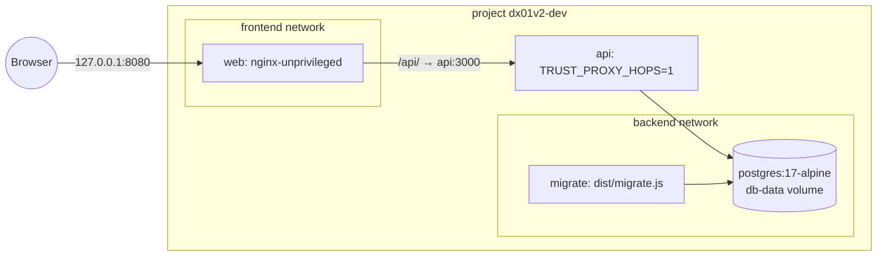
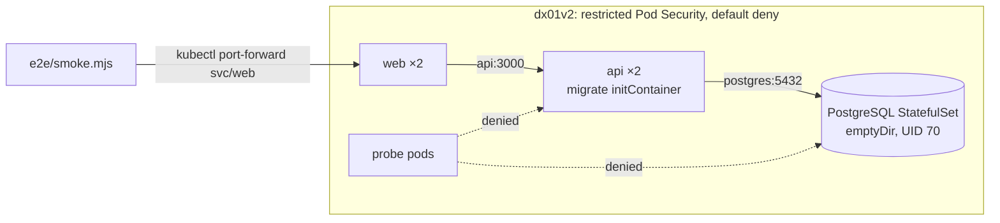
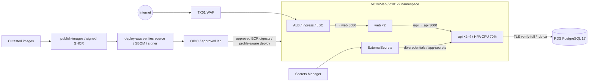

# dx01v2 architecture

Application structure in Compose, kind and EKS, design decisions and changes from v1.
The infrastructure interface is [CONTRACT.md](CONTRACT.md); endpoints are in [API.md](API.md).

## Components

| Component | Purpose | Digest-pinned image |
|---|---|---|
| api | Express 5/strict TypeScript ESM on Node 24: message board, probes and separate metrics port | node:24-alpine3.24 build; distroless nodejs24-debian13:nonroot runtime, UID 65532, no shell/npm |
| migrate | dist/migrate.js applies api/migrations/*.sql under advisory lock | same API image |
| web | React 19/Vite 8 served by nginx; /api proxy | node build; nginx-unprivileged:1.30-alpine-slim, UID 101/8080, without image-filter/xslt/geoip/njs |
| database | PostgreSQL 17 | postgres:17-alpine locally/kind; TX01 RDS in AWS |

## Local Compose, project dx01v2-dev

Database health → successful migration → API /readyz healthy → web. Only web publishes on
127.0.0.1. All containers use read-only root filesystems, cap_drop ALL and no-new-privileges.
scripts/dev-env.sh generates local .env secrets.

## kind, make e2e

One Kubernetes 1.36 node from kind/kind-config.yaml; kind load imports images with
imagePullPolicy Never. Scripts generate random Secrets. kindnet enforces NetworkPolicy since
kind v0.24.0 through kube-network-policies; e2e includes allowed/denied probes.

## AWS EKS, not run in the cloud (v2)

TX owns namespace, deployer RBAC, ClusterSecretStore, ALB Controller, WAF and RDS. DX supplies
Ingress, ExternalSecrets, HPA and NetworkPolicies with VPC-derived ALB→web/API→RDS rules.
SSM values such as image destinations, WAF ARN and CIDR enter temporary params.env and Kustomize
replacements. The current Ingress routes all external paths to web; nginx proxies /api.
Full adds ambient mesh/GitOps; core uses direct deployment. platform_profile must match TX.

## Decisions

1. **One process per container.** Separate API/web images and Deployments; no nginx/Node shell trap
   or improvised supervisor in one container.
2. **Distroless API.** nodejs24-debian13:nonroot has no shell/npm. At the 2026-10-10 baseline,
   Debian 12 still contained Node 24.14 versus 24.21 in Debian 13. Compose health uses
   /nodejs/bin/node -e fetch(...).
3. **Explicit nginx configuration.** server_tokens off, IPv4/IPv6, local /healthz, /api forwarding
   headers, SPA fallback and hashed-asset caching. Include security headers in every location,
   since location add_header overrides inherited headers. HSTS is conditional on forwarded HTTPS;
   HTTP maps to an empty value. Hide upstream API headers to avoid duplicates.
   Read-only root uses /tmp for PID/temp files.
4. **Bounded proxy trust.** TRUST_PROXY_HOPS=1 trusts the immediate proxy in Compose/kind/AWS,
   and ignores untrusted leftmost X-Forwarded-For additions. The current AWS path is
   ALB→nginx→API: this API setting does not establish the original browser address across both
   proxies. WAF applies edge IP controls. Any proxy-hop change needs coordinated security tests;
   do not broaden trust silently.
5. **In-memory write rate limit.** express-rate-limit uses req.ip, default ten/minute, before
   validation so rejected writes count. N replicas permit up to N times that limit; no Redis
   store because of cost/complexity. TX WAF adds edge IP controls. Interpret API client-IP limits
   together with the proxy boundary above.
6. **JSON errors and limits.** Errors use error code/message/requestId. API body limit 10 KB
   returns 413; nginx permits 64k. Non-JSON gives 415; unavailable DB gives db_unavailable/503
   without internal details.
7. **Validated startup.** Zod validates environment and exits with a readable list on failure.
   APP_ENV=lab requires DB_SSL_MODE=verify-full and DB_SSL_CA_FILE.
8. **Recovering database pool.** Lazy pg pool, three-second connection/five-second statement
   timeout; no permanent initialized flag. /readyz SELECT 1 has a one-second bound and resumes
   200 when the database recovers without restarting the process.
9. **Explicit migrations.** Numbered SQL files, transaction per file, pg_advisory_lock for
   concurrent initContainers and schema_migrations checksums; applied files cannot change.
   Kubernetes uses migrate initContainer, Compose a separate migrate service.
10. **Graceful shutdown.** SIGTERM makes readiness 503, server.close drains, pool.end closes and
    spans flush within five seconds. Collector failure cannot make shutdown fail.
    SHUTDOWN_TIMEOUT_MS defaults ten seconds. Kubernetes preStop sleep five seconds allows
    kube-proxy/ALB removal without a distroless shell; sleep was beta/default since 1.30,
    stable in 1.34 per KEP-3960 and available on this 1.36 baseline.
11. **Separate metrics.** OpenMetrics /metrics on 9464 with prom-client defaults and method/
    route-pattern/status histograms (unmatched for 404), plus trace_id exemplars.
    Neither web nor Ingress exposes it; NetworkPolicy permits monitoring namespace.
    Core does not install Prometheus; full integrates the monitoring stack.
12. **Kustomize components.** Neutral base; local, aws, aws-https, aws-full and aws-https-full
    overlays. Full adds ambient mesh; platform_profile must match TX. HPA owns API replicas,
    so spec.replicas is removed. CI renders every overlay with params.example.env.
13. **Pod security.** Restricted PSA, including local PostgreSQL UID 70 with intentionally
    ephemeral emptyDir, no automatic service-account tokens, default-deny policies and only
    necessary permits.
14. **Immutable artifacts.** CI builds once and stores tested images. publish-images signs/
    publishes GHCR digests; deploy-aws validates CI/SBOM/identity, copies to immutable ECR SHA
    tags, confirms image IDs, attests promotion and pins ECR digests in deployment.
    Local tags are e2e or local.
15. **One smoke for all environments.** Dependency-free Node e2e/smoke.mjs targets Compose,
    kind and ALB. SMOKE_BEHIND_WAF=1 expects 403 for bodies above 8 KB rather than API 413.
16. **Manual OpenTelemetry without a loader.** Official API/SDK creates SERVER request and CLIENT
    SQL spans; ESM auto-instrumentation would need a module loader hook. OTLP/HTTP targets
    configured OTEL_EXPORTER_OTLP_ENDPOINT, disabled when absent. W3C context, trace_id/span_id
    logs and exemplars correlate signals. /healthz and /readyz do not generate spans.

## v1 → v2

| v1 problem | v2 response | Evidence |
|---|---|---|
| root container after USER removal | numeric nonroot users/restricted PSA | policy-images, image-policy, contract-app, e2e |
| nginx/Node together with unsupervised shell trap | separate image/Deployment/process | Dockerfiles/base |
| trust proxy=true and leftmost XFF let clients evade limits | explicit hop count/req.ip boundary | policy-app, rate-limit tests, smoke; AWS extra-hop limit above |
| unvalidated spoofed IPs stored | app stores no client IP; IP only keys bounded proxy-derived limit | rate-limit middleware/tests |
| JWT without exp/aud or token acquisition | constant-time 32+ character admin token; absent token returns 503 | admin-auth/config/messages |
| self-defined mocks and ~14% actual coverage | real createApp/supertest/PostgreSQL and coverage floors | API >=80% lines/>=70% branches; web tests |
| no lint | typed eslint, Prettier, strict tsc | eslint/prettier/typecheck |
| ready endpoint unreachable through nginx | direct pod health/readiness; ALB web edge health and separate web health | contract-app; current Ingress/Service checks |
| DB startup never retried | self-recovering pool; migration waits 30×2 seconds | readiness/migration tests |
| CORS/body/JSON rejection became 500 | same-origin, JSON 413/400/415 | messages/smoke |
| pre-escaped HTML corrupted stored data | trim/store text, reject control characters, render text in UI | validation/smoke |
| duplicate/missing asset security headers | per-location snippet, upstream headers hidden | policy-app/smoke |
| HSTS over HTTP | forwarded-HTTPS-only HSTS | policy-app/HTTP smoke |
| Node 20 on Alpine 3.19 | Node 24 on Alpine 3.24/distroless Debian 13; recorded EOLs 2026-04-30/2028-04-30 | version-consistency |
| mutable Trivy latest, affected in March 2026 incident | checksum-pinned CLI, no trivy-action; initial v0.75.0 baseline | policy-workflows/install-tools |
| stale client lock | one workspace package-lock, strict npm ci | npm-ci/version-consistency |
| unsupported README/SECURITY claims | labeled evidence/status matrix | repo-structure/review |
