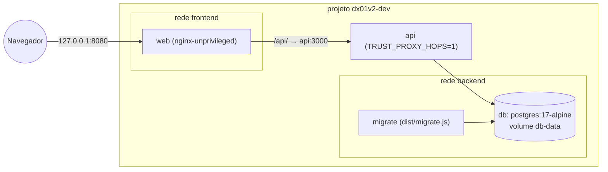
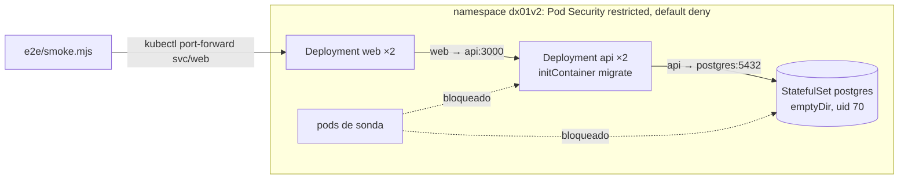
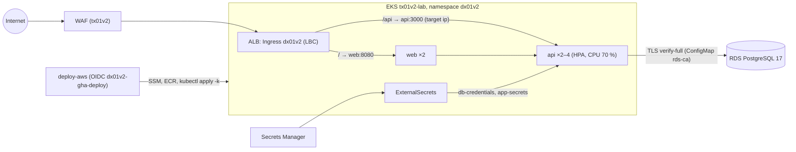

# Arquitetura do dx01v2

Como o app é montado em cada ambiente (compose, kind, EKS), as decisões de design e o que mudou em
relação ao v1. O contrato com a infraestrutura está em `docs/CONTRATO.md`; os endpoints em
`docs/API.md`.

## Componentes

| Componente | O quê | Imagem (por digest) |
|---|---|---|
| `api` | Express 5 + TypeScript estrito (ESM) no Node.js 24: mural de mensagens, probes, métricas em porta separada | build `node:24-alpine3.24`; runtime `gcr.io/distroless/nodejs24-debian13:nonroot` (uid 65532, sem shell, sem npm) |
| `migrate` | `dist/migrate.js` na mesma imagem da API: aplica `api/migrations/*.sql` sob advisory lock | a da API |
| `web` | página React 19 (Vite 8) servida pelo nginx, que também faz proxy de `/api/` para a API | build `node:24-alpine3.24`; runtime `nginxinc/nginx-unprivileged:1.30-alpine-slim` (uid 101, porta 8080; sem os módulos image-filter/xslt/geoip/njs) |
| banco | PostgreSQL 17 | local/kind: `postgres:17-alpine`; AWS: RDS do tx01v2 |

## Local (compose, projeto `dx01v2-dev`)

`db` (healthcheck) → `migrate` (termina com sucesso) → `api` (healthy em `/readyz`) → `web`. Só o web
é publicado, em 127.0.0.1. Todos com root filesystem somente leitura, `cap_drop: [ALL]` e
`no-new-privileges`; segredos do `.env` gerado por `scripts/dev-env.sh`.

## kind (`make e2e`)

Um nó Kubernetes 1.36 (`kind/kind-config.yaml`); imagens carregadas com `kind load` e
`imagePullPolicy: Never`; Secrets aleatórios criados pelo script. O kindnet, CNI padrão do kind,
aplica NetworkPolicy desde o kind v0.24.0 (kube-network-policies), e o e2e prova isso com sondas
permitidas e bloqueadas.

## AWS (EKS do tx01v2, `não executado em nuvem (v2)`)

O namespace, o RBAC do deployer, o ClusterSecretStore, o controller do ALB, o WAF e o RDS são do
tx01v2. O app traz Ingress, ExternalSecrets, HPA e NetworkPolicies por CIDR da VPC (ALB → pods,
API → RDS); os valores do SSM (imagens, ARN do WAF, CIDR) entram por um `params.env` e
`replacements` do kustomize.

## Decisões

1. **Um processo por container.** API e web em imagens e Deployments separados; nada de nginx e Node
   no mesmo container com um trap de shell.
2. **Runtime distroless da API.** `nodejs24-debian13:nonroot`, sem shell nem npm. A variante
   `nodejs24-debian12` sugerida na especificação existe, mas parou de ser reconstruída (ainda tinha o
   Node.js 24.14.0 em 2026-10-10, contra 24.21.0 na debian13), então o v2 usa a debian13. O
   healthcheck do compose é uma linha de Node (`/nodejs/bin/node -e fetch(...)`).
3. **nginx próprio no web.** `default.conf` com `server_tokens off`, IPv4 + IPv6, `/healthz` local,
   `/api/` com os cabeçalhos de encaminhamento padrão, fallback de SPA e cache longo para os assets
   com hash. Os cabeçalhos de segurança ficam em um snippet incluído em **cada** `location` (o nginx
   descarta `add_header` herdados quando a location declara os seus). HSTS só quando
   `X-Forwarded-Proto` é `https` (um `map` deixa o valor vazio em HTTP). Os cabeçalhos da API são
   escondidos no proxy para não duplicar. Root filesystem somente leitura: pid e temporários em `/tmp`.
4. **`trust proxy` como contagem de saltos.** `TRUST_PROXY_HOPS=1` em compose, kind e AWS: há
   exatamente um proxy na frente da API (o nginx, ou o ALB para `/api` na AWS). `req.ip` é o endereço
   que esse proxy viu; entradas falsas à esquerda do `X-Forwarded-For` são ignoradas.
5. **Rate limit de escrita em memória.** `express-rate-limit` por `req.ip`, 10 por minuto por padrão,
   contado antes da validação (escritas rejeitadas também contam). Com N réplicas o limite efetivo
   chega a N vezes; um store compartilhado (Redis) ficou de fora por custo e complexidade, e o WAF do
   tx01v2 limita por IP na borda.
6. **Erros JSON e limites.** Todo erro sai como `{"error":{"code","message","requestId"}}`; corpo
   até 10 kb na API (413), 64k no nginx; 415 para corpo que não é JSON; 503 `db_unavailable` quando o
   banco cai, sem detalhes internos.
7. **Configuração validada na partida.** Um schema zod sobre o ambiente; qualquer problema encerra o
   processo com uma lista legível. Com `APP_ENV=lab`, só `DB_SSL_MODE=verify-full` com
   `DB_SSL_CA_FILE` é aceito.
8. **Banco que se recupera.** Pool `pg` preguiçoso (conexão em 3 s, `statement_timeout` 5 s): sem
   flag de "inicializou"; `/readyz` faz `SELECT 1` com limite de 1 s e volta a 200 quando o banco
   volta, sem reiniciar o processo.
9. **Migrações explícitas.** Arquivos SQL numerados, uma transação por arquivo, `pg_advisory_lock`
   (initContainers concorrentes esperam) e checksum em `schema_migrations` (um arquivo aplicado não
   pode mudar). Rodam no initContainer `migrate` (Kubernetes) e no serviço `migrate` (compose).
10. **Desligamento gracioso.** SIGTERM → `/readyz` 503 → `server.close()` espera as requisições →
    `pool.end()` → flush dos spans pendentes (no máximo 5 s; um Collector fora do ar não transforma o
    desligamento em falha); saída forçada após `SHUTDOWN_TIMEOUT_MS` (10 s). No Kubernetes, `preStop` com a ação
    `sleep` de 5 s (beta e ligada por padrão desde o 1.30, estável no 1.34 segundo o KEP-3960;
    disponível no 1.36 do kind e do EKS) dá tempo para o kube-proxy e o ALB tirarem o pod, sem
    precisar de shell na imagem distroless.
11. **Métricas separadas.** `/metrics` na porta 9464 (prom-client: métricas padrão + histograma por
    método, padrão de rota — `unmatched` para 404 — e status). Nem o web nem o Ingress expõem essa
    porta; a NetworkPolicy só aceita o namespace `monitoring` (não há Prometheus neste lab).
    O formato é OpenMetrics, para o exemplar com o `trace_id` da requisição.
12. **Kustomize com componentes.** `base` neutra; `overlays/local` (kind) e `overlays/aws` /
    `aws-https` (componentes `aws` e `aws-https`). Na AWS o HPA controla as réplicas da API
    (`spec.replicas` removido). O CI renderiza e valida todos os overlays com `params.example.env`.
13. **Segurança de pods.** Pod Security `restricted` em todo pod (inclusive o PostgreSQL do kind, uid
    70 e dados em `emptyDir`, efêmero de propósito), sem token de service account, NetworkPolicies
    que negam tudo e liberam só o necessário.
14. **Imagens imutáveis.** No ECR, tag = SHA completo do commit (tags IMMUTABLE no tx01v2); o deploy
    não reconstrói uma tag que já existe. Localmente a tag é `e2e` (kind) ou `local` (compose).
15. **Um smoke test para todos os ambientes.** `e2e/smoke.mjs` (Node.js puro, sem dependências) roda
    contra o compose, o kind e o ALB; na AWS, `SMOKE_BEHIND_WAF=1` espera o 403 do WAF para corpos
    acima de 8 KB, em vez do 413 da API.
16. **Traces com OpenTelemetry, sem loader.** A API cria os próprios spans (SERVER por requisição,
    CLIENT por consulta dentro dela) com a API e o SDK oficiais do OpenTelemetry, em vez da
    auto-instrumentação, que no ESM exige um hook de carregamento de módulos. Spans em OTLP/HTTP para o
    Collector da plataforma (`OTEL_EXPORTER_OTLP_ENDPOINT`; desligado sem ele), W3C trace context, e o
    trace id nos logs (`trace_id`, `span_id`) e nos exemplars. As sondas `/healthz` e `/readyz` não geram
    span.

## v1 → v2

| Problema no v1 | Como o v2 resolve | Onde é verificado |
|---|---|---|
| Container rodando como root (o `USER` foi removido depois) | `USER` numérico não root nas duas imagens; Pod Security `restricted` | `policy-images`, `image-policy:*`, `contract-app`, e2e |
| nginx + node no mesmo container, com trap de shell e sem supervisão | uma imagem e um Deployment por processo | Dockerfiles, `deploy/k8s/base` |
| `trust proxy = true` + `X-Forwarded-For` mais à esquerda: rate limit burlável | `TRUST_PROXY_HOPS` (contagem de saltos) e limite por `req.ip` | `policy-app`, teste `rate-limit`, smoke |
| IPs falsificados gravados sem validação | a API não grava IPs; o único uso do IP é a chave do limite, derivada só dos saltos confiáveis | código (`api/src/middleware/rate-limit.ts`), teste `rate-limit` |
| JWT aceito sem `exp`/`aud` e sem como obter um token | sem JWT: um token de admin de 32+ caracteres, comparado em tempo constante; sem token a rota responde 503 | testes `admin-auth`, `config`, `messages` |
| Testes de mocks definidos no próprio arquivo (~14 % de cobertura real) | supertest contra o `createApp()` real e um PostgreSQL real; limites de cobertura | `test:api` (>= 80 % linhas, >= 70 % branches), `test:web` |
| Sem linter | eslint type-aware, prettier e tsc estrito | `eslint`, `prettier`, `typecheck:*` |
| `/ready` inacessível pelo nginx | probes direto no pod da API (`/healthz`, `/readyz`); health check do ALB em `/readyz`; o web tem o próprio `/healthz` | `contract-app` |
| Inicialização do banco sem nova tentativa | pool que se recupera sozinho; `migrate` espera o banco (30 × 2 s) | testes `readiness`, `migrations` |
| Rejeição de CORS, limite de corpo e JSON inválido viravam 500 | sem CORS (mesma origem); 413, 400 e 415 em JSON | teste `messages`, smoke |
| HTML escapado antes de gravar (dados corrompidos) | texto gravado como recebido (após `trim`), caracteres de controle rejeitados; a UI renderiza texto | teste `validation`, smoke |
| Cabeçalhos de segurança duplicados e nenhum nos assets estáticos | snippet incluído em cada `location`; cabeçalhos da API escondidos no proxy | `policy-app`, smoke |
| HSTS enviado em HTTP puro | HSTS só com `X-Forwarded-Proto: https` | `policy-app`, smoke (sem HSTS em HTTP) |
| Node.js 20 (fim em 2026-04-30) no Alpine 3.19 | Node.js 24 (fim em 2028-04-30) no Alpine 3.24 e no distroless Debian 13 | `version-consistency` |
| Imagem do trivy sem versão (`latest`, maliciosa por alguns dias em março de 2026) | trivy v0.75.0 por SHA256 via `install-tools.sh`; nada de `trivy-action` | `policy-workflows`, `install-tools.sh` |
| Lockfile do cliente fora de sincronia | um `package-lock.json` na raiz (workspaces) e `npm ci` sempre no modo estrito | `npm-ci`, `version-consistency` |
| README/SECURITY com afirmações falsas | matriz de status com rótulos e evidência | `repo-structure`, revisão |
